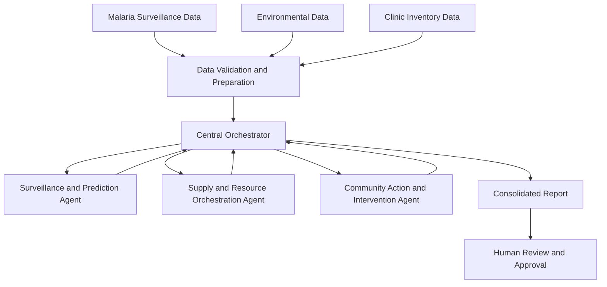

# MalariaPulse System Architecture

## 1. Overview

MalariaPulse is designed as a multi-agent system that connects malaria surveillance and forecasting with healthcare resource planning and community intervention.

The system consists of three specialized agents coordinated by a central orchestrator. Each agent has a defined responsibility, receives structured inputs, and produces outputs that can be consumed by the next stage of the workflow.

The initial implementation will prioritize a small, testable workflow using available datasets and existing forecasting models.

## 2. High-Level Architecture



The central orchestrator manages the workflow, passes information between agents, and collects their outputs. Data validation occurs before the information is used for analysis.

## 3. Core Components

### 3.1 Data Ingestion and Validation

**Purpose:** Prepare available data for analysis.

Responsibilities:
- Load weekly malaria case reports.
- Load environmental indicators when available.
- Load clinic inventory records.
- Validate required columns, data types, reporting periods, and location identifiers.
- Identify missing values, duplicate records, and inconsistent data.
- Report data-quality limitations before downstream analysis.

Potential inputs:
- CSV files for the first prototype.
- Existing research datasets.
- Approved data sources and APIs in later phases.

The system must distinguish between missing data and a genuine zero count.

### 3.2 Surveillance and Prediction Agent

**Purpose:** Identify unusual malaria trends and estimate potential localized risk.

Responsibilities:
- Analyze historical malaria case counts.
- Use the team's existing forecasting models where possible.
- Compare recent observations against historical baselines or model predictions.
- Produce preliminary risk assessments with supporting evidence.
- Identify insufficient data and other limitations.

Example output:

```json
{
  "location_id": "ZONE_A",
  "risk_level": "elevated",
  "reporting_period": "2026-W35",
  "evidence": [
    "Reported cases exceeded the selected historical baseline"
  ],
  "limitations": [
    "Risk classification requires validation"
  ],
  "requires_review": true
}
```

The example is illustrative. Risk levels, thresholds, and model outputs must be established and evaluated using appropriate data before operational use.

### 3.3 Supply and Resource Orchestration Agent

**Purpose:** Identify potential healthcare supply gaps and prepare resource recommendations.

Responsibilities:
- Examine current stock levels of malaria-related commodities.
- Compare inventory with configured minimum stock levels.
- Consider surveillance findings when prioritizing locations for review.
- Draft restocking or redistribution recommendations.
- Explain which inventory values informed each recommendation.

Potential commodities include:
- Rapid diagnostic test (RDT) kits.
- Artemisinin-based combination therapy (ACT) medicines.
- Insecticide-treated bed nets.

Future versions may consider delivery lead times, expiry dates, facility capacity, transport constraints, and verified stock availability.

The agent must not execute procurement or redistribution actions without authorization.

### 3.4 Community Action and Intervention Agent

**Purpose:** Convert reviewed surveillance findings into relevant public-health communication drafts.

Responsibilities:
- Generate prevention and early-diagnosis messages.
- Tailor content to community health workers or residents.
- Support English and Swahili initially.
- Incorporate only claims supported by approved guidance and available evidence.
- Flag messages requiring clinical or public-health review.

Potential outputs:
- Community outreach message drafts.
- Community health worker briefing notes.
- Prevention reminders.
- Draft advisories for authorized review.

Translation quality and local suitability must be evaluated before messages are distributed. Automated public messaging is outside the initial prototype scope.

### 3.5 Central Orchestrator

**Purpose:** Coordinate agent execution and manage the flow of information.

Responsibilities:
- Validate workflow inputs.
- Invoke agents in the appropriate sequence.
- Pass structured outputs between agents.
- Handle failures and incomplete results.
- Consolidate results into a single report.
- Record the assumptions and outputs needed for traceability.

The orchestrator should use explicit interfaces rather than relying on agents to exchange unstructured conversational text alone.

## 4. End-to-End Workflow

1. Load surveillance, environmental, and inventory data.
2. Validate the inputs and report data-quality issues.
3. Run the surveillance analysis or forecasting model.
4. Produce a preliminary location-level risk assessment.
5. Pass relevant results to the supply agent.
6. Generate draft inventory recommendations.
7. Pass reviewed or reviewable findings to the community agent.
8. Generate localized communication drafts.
9. Combine the results into a consolidated report.
10. Present the report for authorized human review.

If the surveillance stage fails or the available data is insufficient, downstream agents should receive an explicit status indicating that reliable recommendations cannot be produced. They should not silently treat missing results as evidence of low risk.

## 5. Agent Communication

Agents should exchange structured data using agreed schemas.

Each result should contain, where applicable:
- Location identifier.
- Reporting period.
- Input data references.
- Result or recommendation.
- Supporting evidence.
- Assumptions and limitations.
- Model or rule version.
- Review status.

This makes the workflow easier to test, debug, evaluate, and audit.

## 6. Proposed Technology Stack

| Layer | Proposed technology |
|---|---|
| Programming language | Python |
| Data processing | Pandas and NumPy |
| Forecasting | Existing team models and appropriate evaluation tools |
| Agent coordination | Python orchestrator with tool calling |
| Language model | Tool-calling-capable LLM, selected after requirements review |
| Prototype interface | Streamlit or an existing team interface |
| Initial data format | CSV |
| Version control | Git and GitHub |

The team should begin with the simplest architecture that supports a working demonstration. A multi-agent framework or external integrations should be added only when they solve a specific need.

## 7. Reliability, Safety, and Evaluation

MalariaPulse is intended to support professional decision-making, not replace it.

Key requirements:
- Validate input data before analysis.
- Evaluate forecasting performance against historical observations and appropriate baselines.
- Document the evidence and thresholds behind risk classifications.
- Avoid presenting environmental correlations as proof of causation.
- Clearly distinguish model estimates from observed case counts.
- Require authorized review of public-health messages and resource recommendations.
- Keep credentials and sensitive data out of the repository.
- Record enough provenance to reproduce and investigate results.

## 8. Initial Implementation Boundary

The first prototype should demonstrate:
- A working surveillance-analysis step.
- A structured risk assessment.
- An inventory check that generates draft recommendations.
- A community message-generation step.
- An orchestrator that combines the outputs.
- A clear human-review requirement.

Real-time ingestion, validated outbreak prediction, optimized logistics, and automatic message delivery should remain future work until the data, evaluation, and governance requirements are established.

## 9. Open Architecture Questions

The team should agree on:
1. Which forecasting model and dataset will be integrated first?
2. What geographic unit is supported by the available data?
3. Which variables are reliably available at the required reporting frequency?
4. How will elevated risk be evaluated and validated?
5. What inventory and operational constraints are available?
6. Who reviews and approves each type of recommendation?
7. What evidence is required before any real-world pilot?